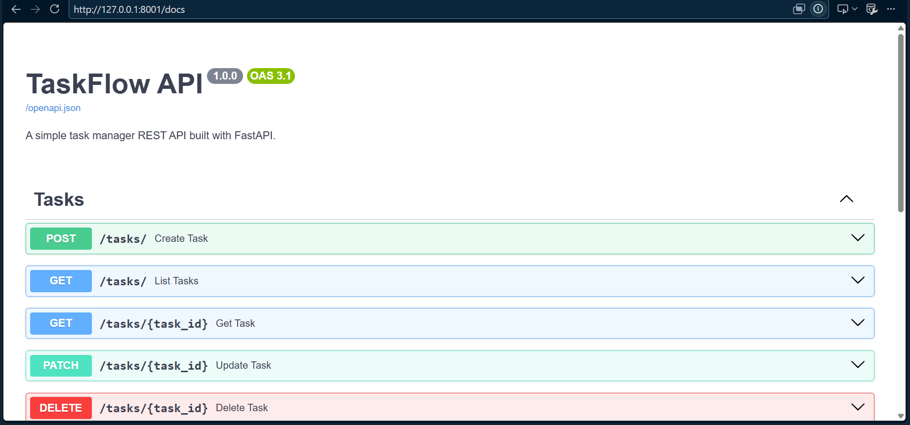

# TaskFlow API

A beginner-friendly REST API for managing tasks, built with **FastAPI**, **SQLAlchemy** and **SQLite**.

## Demo


## Features
- Full CRUD (Create, Read, Update, Delete) for tasks
- Request validation with Pydantic
- Filtering (`?completed=true`) and pagination (`?skip=0&limit=10`)
- Auto-generated API docs (Swagger UI)
- Automated tests with Pytest

## Tech Stack
Python 3.10+, FastAPI, SQLAlchemy 2.0, SQLite, Pytest

## Project Structure
```
app/
  main.py          # App entry point
  database.py      # DB connection and session
  models.py        # SQLAlchemy models
  schemas.py       # Pydantic schemas
  routers/tasks.py # Task endpoints
tests/
  test_tasks.py
```

## Run Locally
```bash
python -m venv .venv
source .venv/bin/activate        # Windows: .venv\Scripts\activate
pip install -r requirements.txt
uvicorn app.main:app --reload
```
Open http://127.0.0.1:8000/docs

## Run Tests
```bash
pytest
```

## API Endpoints
| Method | Endpoint | Description |
|--------|----------|-------------|
| POST | /tasks/ | Create a task |
| GET | /tasks/ | List tasks (filter + pagination) |
| GET | /tasks/{id} | Get one task |
| PATCH | /tasks/{id} | Update a task |
| DELETE | /tasks/{id} | Delete a task |

## Future Improvements
- JWT authentication and user accounts
- Docker support
- PostgreSQL instead of SQLite
